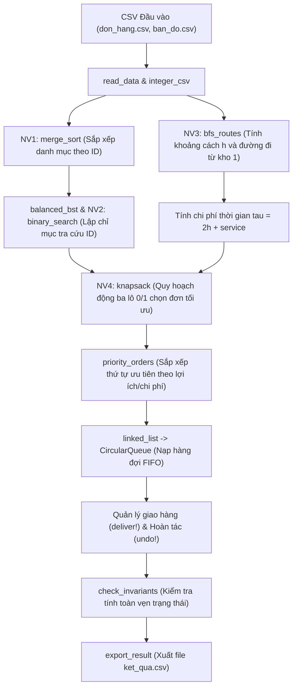

# BÁO CÁO THỰC HÀNH CẤU TRÚC DỮ LIỆU VÀ GIẢI THUẬT
## ĐIỀU PHỐI GIAO ĐƠN TRONG KHUÔN VIÊN TRƯỜNG BẰNG JULIA

- **Họ và tên:** Huỳnh Nguyễn Tiến Anh
- **Mã số sinh viên (MSSV):** N24DCDT001
- **Lớp:** D24CQDT01-N
- **Repository GitHub:** [https://github.com/anhtienhao66a-dotcom/thuchanhbuoi5.git](https://github.com/anhtienhao66a-dotcom/thuchanhbuoi5.git)
- **Commit SHA:** (Commit HEAD trên repository)
- **Phiên bản Julia:** Julia 1.13.0
- **Ngày thực hành:** 09/10/2026 (Hoàn thiện: 13/10/2026)

---

## 1. Bài toán và dữ liệu

### 1.1. Mục tiêu bài toán
Bài toán đặt ra yêu cầu xây dựng một ứng dụng điều phối giao hàng trong khuôn viên trường đại học (mô hình đồ thị 6 đỉnh và 7 cạnh). Xuất phát từ kho trung tâm (đỉnh 1), shipper thực hiện các chuyến giao hàng độc lập tới các địa điểm giao (từ đỉnh 2 đến đỉnh 6) rồi quay trở lại kho 1.
Mục tiêu là lựa chọn một tập hợp các đơn hàng không trùng lặp sao cho tổng thời gian thực hiện không vượt quá ngân sách thời gian $B$ cho trước, đồng thời tối đa hóa tổng lợi ích nhận được. Đây là bài toán ba lô 0/1 (0/1 Knapsack Problem) kết hợp với tìm đường đi ngắn nhất trên đồ thị (BFS).

### 1.2. Dữ liệu đầu vào và các bộ dữ liệu
Hệ thống sử dụng 2 tệp CSV đầu vào không dùng thư viện ngoài:
1. `don_hang.csv`: Chứa thông tin các đơn hàng với 4 cột (`id, diem_giao, thoi_gian_phuc_vu, loi_ich`).
2. `ban_do.csv`: Chứa danh sách các cạnh vô hướng của khuôn viên trường với 2 cột (`u, v`).

**Các bộ dữ liệu thử nghiệm:**
- **Bộ MINI001 (Dữ liệu mẫu chuẩn):** Gồm 3 đơn hàng (ID 1, 2, 3), ngân sách thời gian $B = 8$.
  - Đơn 1: Đích 2, phục vụ 1, lợi ích 6.
  - Đơn 2: Đích 4, phục vụ 1, lợi ích 8.
  - Đơn 3: Đích 6, phục vụ 1, lợi ích 10.
- **Bộ mở rộng cá nhân hóa theo MSSV `N24DCDT001`:**
  - Ngân sách $B = 28$, số đơn hàng $n = 8$.
  - Lệnh tạo và đọc dữ liệu:
    ```bash
    julia TH_2026_10_09_Sinh_vien.jl --data N24DCDT001
    ```

---

## 2. Sơ đồ xử lý và mô hình dữ liệu

### 2.1. Sơ đồ luồng xử lý dữ liệu (Pipeline)


### 2.2. Vai trò của các cấu trúc dữ liệu
- `Order`: Struct lưu trữ thông tin cố định của mỗi đơn hàng: mã đơn `id`, điểm giao `destination`, thời gian phục vụ `service`, lợi ích `benefit`.
- `sorted_ids`: Vector chứa danh mục các đơn hàng đã được sắp xếp tăng dần theo `id` bằng `merge_sort`, làm tiền đề cho `binary_search`.
- `costs` & `routes`: `Dict{Int, Int}` ánh xạ từ `id` đơn hàng sang tổng chi phí thời gian $\tau$ và đường đi chi tiết từ kho 1.
- `balanced_bst`: Cây tìm kiếm nhị phân dựng cân bằng từ trung vị của mảng `sorted_ids`, phục vụ tra cứu $O(h)$ trong suốt chu trình giao hàng.
- `CircularQueue` (`pending`): Hàng đợi vòng FIFO lưu trữ danh sách các đơn hàng đang chờ giao theo thứ tự ưu tiên.
- `completed`: Ngăn xếp (danh sách động dùng như LIFO) lưu lịch sử các đơn hàng đã giao thành công, hỗ trợ thao tác hoàn tác (`undo!`).
- **Bất biến trạng thái (Invariants):**
  $$\text{Set}(\text{pending}) \cap \text{Set}(\text{completed}) = \emptyset$$
  $$\text{Set}(\text{pending}) \cup \text{Set}(\text{completed}) = \text{Set}(\text{selected\_ids})$$
  $$\text{spent} = \sum_{id \in \text{completed}} \text{costs}[id] \le \text{budget}, \quad \text{earned} = \sum_{id \in \text{completed}} \text{benefit}[id]$$

---

## 3. Ý tưởng thuật toán và truy vết

### 3.1. NV1 · Sắp xếp trộn (`merge_sort`)
- **Đầu vào / Đầu ra:** Nhận vector `a::AbstractVector` và hàm so sánh `before::Function`. Trả về một vector mới đã sắp xếp, không làm biến đổi vector gốc.
- **Ý tưởng:** Áp dụng mô hình Chia để trị (Divide and Conquer). Nếu `length(a) <= 1`, trả về bản sao `copy(a)`. Ngược lại, chia đôi vector tại `mid = div(length(a), 2)`, đệ quy sắp xếp hai nửa `left` và `right`, sau đó trộn (merge) hai dãy đã có thứ tự.
- **Tính ổn định (Stability):** Khi hai phần tử có thứ tự hòa nhau (neither `before(y, x)`), thuật toán ưu tiên lấy phần tử bên nhánh trái `left` trước: `if before(right[j], left[i]) take right else take left`.
- **Độ phức tạp:** Thời gian $O(n \log n)$, không gian phụ $O(n)$.

### 3.2. NV2 · Tìm kiếm nhị phân (`binary_search`)
- **Đầu vào / Đầu ra:** Nhận `a::Vector{Order}` đã sắp tăng theo ID và `id::Int` cần tìm. Trả về `Order` tương ứng hoặc `nothing` nếu không tìm thấy.
- **Ý tưởng:** Thiết lập hai con trỏ `lo = 1, hi = length(a)`. Khi `lo <= hi`, tính chỉ số giữa `mid = lo + div(hi - lo, 2)`. Nếu `a[mid].id == id` thì trả về bản ghi; nếu `a[mid].id < id` thì thu hẹp sang nửa phải (`lo = mid + 1`); ngược lại sang nửa trái (`hi = mid - 1`). Khi vòng lặp kết thúc mà chưa tìm thấy, trả về `nothing`.
- **Độ phức tạp:** Thời gian $O(\log n)$, không gian phụ $O(1)$.
- **Bảng truy vết tìm kiếm ID 2 trên mảng 3 đơn `[1, 2, 3]`:**

| Lần lặp | `lo` | `hi` | `mid` | Khóa `a[mid].id` | So sánh với `id=2` | Quyết định |
| :---: | :---: | :---: | :---: | :---: | :---: | :---: |
| 1 | 1 | 3 | 2 | 2 | $2 == 2$ | Tìm thấy, trả về `Order(2, 4, 1, 8)` |

### 3.3. NV3 · Duyệt theo chiều rộng (`bfs_routes`)
- **Đầu vào / Đầu ra:** Đồ thị `graph` (danh sách kề) và đỉnh nguồn `source = 1`. Trả về named tuple `(distance, parent, routes)`.
- **Ý tưởng:** Sử dụng hàng đợi vòng FIFO `CircularQueue`. Khởi tạo `distance` toàn bộ bằng $-1$, `parent` bằng $0$. Gán `distance[source] = 0` và đưa `source` vào hàng đợi. Mỗi bước rút một đỉnh $u$ ra, duyệt các đỉnh kề $v$; nếu `distance[v] == -1` thì cập nhật `distance[v] = distance[u] + 1`, `parent[v] = u` và enqueue $v$ ngay lập tức. Sau đó, truy vết ngược từ từng đỉnh $v$ về $source$ qua `parent` để xây dựng `routes[v]`.
- **Độ phức tạp:** Thời gian $O(V + E)$, không gian phụ $O(V)$ (và $O(V^2)$ để lưu các đường đi).
- **Tính toán chi phí thời gian cho bộ MINI001:**

| ID | Điểm giao | Đường đi BFS ($1 \to v$) | Số cạnh $h$ | Thời gian phục vụ $s$ | Chi phí $\tau = 2h + s$ |
| :---: | :---: | :---: | :---: | :---: | :---: |
| 1 | 2 | $1 \to 2$ | 1 | 1 | $2 \times 1 + 1 = 3$ |
| 2 | 4 | $1 \to 2 \to 4$ | 2 | 1 | $2 \times 2 + 1 = 5$ |
| 3 | 6 | $1 \to 2 \to 4 \to 6$ | 3 | 1 | $2 \times 3 + 1 = 7$ |

### 3.4. NV4 · Quy hoạch động ba lô 0/1 (`knapsack`)
- **Đầu vào / Đầu ra:** `orders::Vector{Order}`, `costs::Dict{Int, Int}`, `budget::Int`. Trả về `(ids, value, cost, table)`.
- **Ý tưởng:** Bảng `table[i+1, b+1]` đại diện cho giá trị $F(i, b)$ - lợi ích tối đa khi xét $i$ đơn hàng đầu tiên với ngân sách $b$.
  - Cơ sở: $F(0, b) = 0$ với mọi $0 \le b \le B$.
  - Công thức truy hồi:
    $$F(i, b) = \begin{cases} F(i-1, b) & \text{nếu } c_i > b \\ \max(F(i-1, b), v_i + F(i-1, b - c_i)) & \text{nếu } c_i \le b \end{cases}$$
  - Quy tắc hòa: Khi hai phương án có cùng lợi ích, ưu tiên giữ phương án không lấy đơn $i$.
  - Truy vết: Lùi từ $i = n, b = B$; nếu `table[i+1, curr_b+1] > table[i, curr_b+1]` thì đơn $i$ được chọn, đưa `orders[i].id` vào kết quả và giảm `curr_b -= c_i`.
- **Giải thích ô $F(2, 8)$ (vị trí `table[3, 9]`):**
  - Không lấy đơn 2: $F(1, 8) = 6$.
  - Lấy đơn 2 ($c_2 = 5, v_2 = 8$): $v_2 + F(1, 8 - 5) = 8 + F(1, 3) = 8 + 6 = 14$.
  - Chọn $\max(6, 14) = 14 \Rightarrow F(2, 8) = 14$.

---

## 4. Kiểm thử và kết quả thực tế

### 4.1. Kết quả kiểm thử tự động (`TH_2026_10_09_Kiem_thu.jl`)
Toàn bộ 6 pha kiểm thử đều đạt 100% với tổng cộng 60 phép kiểm tra:

| Pha kiểm thử | Lệnh thực thi | Kết quả mong đợi | Kết quả thực tế | Đánh giá |
| :--- | :--- | :--- | :--- | :---: |
| `data` | `julia TH_2026_10_09_Kiem_thu.jl --phase=data` | 12 phép kiểm tra | ĐẠT 12 phép kiểm tra | **ĐẠT** |
| `sort` | `julia TH_2026_10_09_Kiem_thu.jl --phase=sort` | 8 phép kiểm tra | ĐẠT 8 phép kiểm tra | **ĐẠT** |
| `search` | `julia TH_2026_10_09_Kiem_thu.jl --phase=search` | 5 phép kiểm tra | ĐẠT 5 phép kiểm tra | **ĐẠT** |
| `bfs` | `julia TH_2026_10_09_Kiem_thu.jl --phase=bfs` | 7 phép kiểm tra | ĐẠT 7 phép kiểm tra | **ĐẠT** |
| `dp` | `julia TH_2026_10_09_Kiem_thu.jl --phase=dp` | 12 phép kiểm tra | ĐẠT 12 phép kiểm tra | **ĐẠT** |
| `app` | `julia TH_2026_10_09_Kiem_thu.jl --phase=app` | 16 phép kiểm tra | ĐẠT 16 phép kiểm tra | **ĐẠT** |
| **Tổng thể (`all`)** | `julia TH_2026_10_09_Kiem_thu.jl --phase=all` | **60 phép kiểm tra** | **ĐẠT 60 phép kiểm tra** | **XUẤT SẮC** |

### 4.2. Nhật ký chu trình giao và hoàn tác (Bộ MINI001)

| Bước thực hiện | Thao tác | Hàng đợi `pending` | Ngăn xếp `completed` | Thời gian dùng (`spent`) | Lợi ích nhận (`earned`) |
| :--- | :--- | :---: | :---: | :---: | :---: |
| 1 | Sau lập kế hoạch | `[1, 2]` | `[]` | 0 | 0 |
| 2 | Giao đơn đầu (đơn 1) | `[2]` | `[1]` | 3 | 6 |
| 3 | Hoàn tác đơn 1 | `[1, 2]` | `[]` | 0 | 0 |
| 4 | Giao lại đơn 1 | `[2]` | `[1]` | 3 | 6 |
| 5 | Giao tiếp đơn 2 | `[]` | `[1, 2]` | 8 | 14 |

### 4.3. Kết quả chạy bộ dữ liệu cá nhân hóa MSSV `N24DCDT001`
- Lệnh chạy: `julia TH_2026_10_09_Sinh_vien.jl N24DCDT001`
- Số lượng đơn: $n = 8$ đơn hàng, ngân sách thời gian $B = 28$.
- Kết quả đối chiếu 3 thuật toán:
  - **Quy hoạch động (DP):** 45
  - **Vét cạn (Brute-force):** 45
  - **Tham lam (Greedy):** 45
- Các đơn hàng được chọn: `[2, 8, 5, 4, 3, 7]`.
- Tổng chi phí thời gian: $3 + 3 + 3 + 6 + 6 + 5 = 26 \le 28$.
- Tổng lợi ích: $13 + 7 + 5 + 9 + 6 + 5 = 45$.
- Bất biến hệ thống được bảo toàn trọn vẹn trong suốt chu trình giao, hoàn tác và xuất file kết quả.

---

## 5. Phân tích độ phức tạp và giới hạn thuật toán

### 5.1. Bảng tổng hợp độ phức tạp

| Thuật toán | Độ phức tạp thời gian | Bộ nhớ phụ | Ghi chú |
| :--- | :---: | :---: | :--- |
| `merge_sort` | $O(n \log n)$ | $O(n)$ | $\log_2 n$ tầng chia, mỗi tầng trộn $O(n)$, ổn định khóa trùng |
| `binary_search` | $O(\log n)$ | $O(1)$ | Không gian tìm kiếm giảm một nửa sau mỗi phép so sánh |
| `bfs_routes` | $O(V + E)$ | $O(V)$ | Tìm đường ít cạnh nhất trên đồ thị không trọng số; lưu `routes` tốn $O(V^2)$ |
| `knapsack` | $O(n \cdot B)$ | $O(n \cdot B)$ | Phụ thuộc giá trị giả đa thức của $B$; truy vết mất $O(n)$ |

### 5.2. Các giới hạn và điều kiện áp dụng
1. **Giới hạn của BFS:** BFS chỉ đảm bảo tìm đường đi ngắn nhất khi các cạnh có trọng số đồng nhất (1 đơn vị). Nếu mỗi đoạn đường có thời gian di chuyển khác nhau (trọng số không âm), bắt buộc phải sử dụng thuật toán Dijkstra.
2. **Giới hạn của Tham lam:** Thuật toán tham lam (Greedy) lựa chọn đơn theo tỷ số $\text{benefit}/\tau$ giảm dần thường bỏ lỡ kết hợp tối ưu giữa các đơn hàng do không xét hết khoảng trống ngân sách, chỉ thích hợp cho bài toán ba lô dạng phân số (Fractional Knapsack).
3. **Tra cứu BST:** BST cơ bản có chi phí tra cứu $O(h)$. Nếu cây bị suy biến thành danh sách liên kết lệch, $h = n$ và chi phí tra cứu trở thành $O(n)$. Do đó cần dùng mảng sắp xếp chọn trung vị (`balanced_bst`) hoặc cây tự cân bằng (AVL/Red-Black).
4. **Vét cạn:** Độ phức tạp $O(n \cdot 2^n)$ chỉ khả thi khi $n \le 20$. Với bộ dữ liệu lớn, vét cạn hoàn toàn bất khả thi về mặt thời gian.

---

## 6. Kết luận và hướng dẫn tái lập kết quả

### 6.1. Kết luận
- Đã hoàn thiện toàn diện 4 hàm thuật toán cốt lõi: `merge_sort`, `binary_search`, `bfs_routes`, `knapsack` trong `TH_2026_10_09_Sinh_vien.jl`.
- Tất cả 60 phép kiểm tra tự động trong `TH_2026_10_09_Kiem_thu.jl` đều ĐẠT.
- Notebook Pluto `TH_2026_10_09_Pluto.jl` đã được kích hoạt chạy đầy đủ.
- Dữ liệu mở rộng theo MSSV `N24DCDT001` đã sinh và thực thi trọn vẹn chu trình, xuất file kết quả `data/N24DCDT001/ket_qua.csv`.

### 6.2. Hướng dẫn chạy lại từ đầu (Reproducibility)
1. Clone repository từ GitHub:
   ```bash
   git clone https://github.com/anhtienhao66a-dotcom/thuchanhbuoi5.git
   cd thuchanhbuoi5
   ```
2. Chạy toàn bộ bộ kiểm thử tự động:
   ```bash
   julia TH_2026_10_09_Kiem_thu.jl --phase=all
   ```
3. Chạy demo bộ mẫu MINI001:
   ```bash
   julia TH_2026_10_09_Sinh_vien.jl --mini
   ```
4. Chạy notebook Pluto mẫu:
   ```bash
   julia TH_2026_10_09_Pluto.jl
   ```
5. Chạy bộ dữ liệu cá nhân hóa sinh viên MSSV `N24DCDT001`:
   ```bash
   julia TH_2026_10_09_Sinh_vien.jl --data N24DCDT001
   julia TH_2026_10_09_Sinh_vien.jl N24DCDT001
   ```
